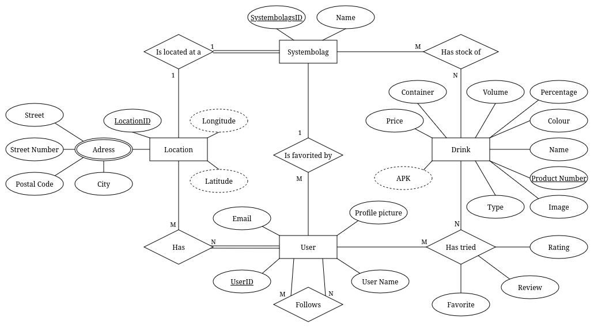
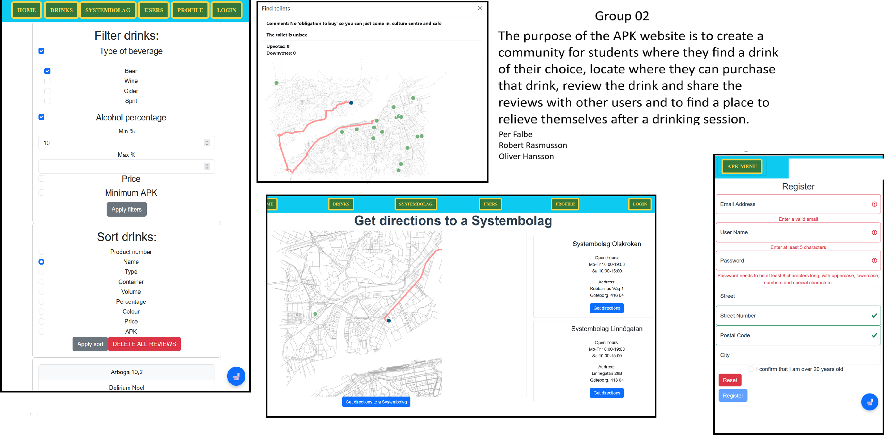

# Backend and Frontend Template

Latest version: https://git.chalmers.se/courses/dit342/group-00-web

This template refers to itself as `group-00-web`. In your project, use your group number in place of `00`.

## Project Structure

| File                                                 | Purpose                     | What you do?                             |
| ---------------------------------------------------- | --------------------------- | ---------------------------------------- |
| `server/`                                            | Backend server code         | All your server code                     |
| [server/README.md](server/README.md)                 | Everything about the server | **READ ME** carefully!                   |
| `client/`                                            | Frontend client code        | All your client code                     |
| [client/README.md](client/README.md)                 | Everything about the client | **READ ME** carefully!                   |
| [docs/LOCAL_DEPLOYMENT.md](docs/LOCAL_DEPLOYMENT.md) | Local production deployment | Deploy your app local in production mode |

## Requirements

The version numbers in brackets indicate the tested versions but feel free to use more recent versions.
You can also use alternative tools if you know how to configure them (e.g., Firefox instead of Chrome).

- [Git](https://git-scm.com/) (v2) => [installation instructions](https://www.atlassian.com/git/tutorials/install-git)
  - [Add your Git username and set your email](https://docs.github.com/en/get-started/git-basics/setting-your-username-in-git)
    - `git config --global user.name "YOUR_USERNAME"` => check `git config --global user.name`
    - `git config --global user.email "email@example.com"` => check `git config --global user.email`
  - > **Windows users**: We recommend to use the [Git Bash](https://www.atlassian.com/git/tutorials/git-bash) shell from your Git installation or the Bash shell from the [Windows Subsystem for Linux](https://docs.microsoft.com/en-us/windows/wsl/install-win10) to run all shell commands for this project.
- [Chalmers GitLab](https://git.chalmers.se/) => Login with your **Chalmers CID** choosing "Sign in with" **Chalmers Login**. (contact [support@chalmers.se](mailto:support@chalmers.se) if you don't have one)
  - DIT342 course group: https://git.chalmers.se/courses/dit342
  - [Setup SSH key with Gitlab](https://docs.gitlab.com/user/ssh/#generate-an-ssh-key-pair)
    - Create an SSH key pair `ssh-keygen -t ed25519 -C "email@example.com"` (skip if you already have one)
    - Add your public SSH key to your Gitlab profile under https://git.chalmers.se/-/user_settings/ssh_keys
    - Make sure the email you use to commit is registered under https://git.chalmers.se/-/profile/emails
  - Checkout the [Backend-Frontend](https://git.chalmers.se/courses/dit342/group-00-web) template `git clone git@git.chalmers.se:courses/dit342/group-00-web.git`
- [Server Requirements](./server/README.md#Requirements)
- [Client Requirements](./client/README.md#Requirements)

## Getting started

```bash
# Clone repository
git clone git@git.chalmers.se:courses/dit342/group-00-web.git

# Change into the directory
cd group-00-web

# Setup backend
cd server && npm install
npm run dev

# Setup frontend
cd client && npm install
npm run serve
```

> Check out the detailed instructions for [backend](./server/README.md) and [frontend](./client/README.md).

## Visual Studio Code (VSCode)

Open the `server` and `client` in separate VSCode workspaces or open the combined [backend-frontend.code-workspace](./backend-frontend.code-workspace). Otherwise, workspace-specific settings don't work properly.

## System Definition (MS0)

### Purpose

As students are generally low on cash and the life at university is full of parties, we would like to help students in enhancing
their university experience. Our solution is to provide a website with services, such as calculating the APK (Alkohol-per-Krona)
of various drinks and allowing users to rate and review drinks for others to see.
The system will be using Systembolaget's API to fetch the data needed.

### Pages

- Home:
  - This is the landing page of the website.
  - The user will have access to shortcuts (e.g. to the APK page) and some updates from friends such as their latest reviews.
- APK:
  - Here the users can see the APK of a variety of drinks at Systembolaget.
  - The users can here filter drinks on different categories, such as type, character and so on.
- Find Systembolag:
  - The users will be able to find a systembolag based on some condition.
  - The conditions are nearest to current location (phone GPS), nearest to home (user's address) and favorite systembolag.
- Profile:
  - Each user will have their own profile, with name, profile picture and their rated and reviewed drinks.
  - Other users visiting a specific profile will see, besides the user's profile picture and their introduction, their
    recommended drinks.

### Entity-Relationship (ER) Diagram



### Proposal for the Advanced Feature

#### The idea:
- Allow users to find the nearest public toilet, and how to get there.

#### How it's done:
1. Page requests coordinates from a user (current GPS location).
2. If a user allows access to their current GPS location, the frontend will send a request, for the info needed to put the map together for the user, to the backend. The request also includes the user's coordinates.
3. The backend then builds the URL to call the Refuge API to fetch the coordinates of the nearest n public toilets based on the user's current location.
4. The response returned by the Refuge API contains the requested n nearest public toilets, together with their coordinates, establishments and more.
5. The backend then extracts the needed information (e.g. coordinates and establishments), some useful information (e.g. accessibility and gendered or unisex), and some generally interesting information (e.g. upvotes and downvotes).
6. The backend then calculates the user's map index based on their coordinates (to be uset for fetching the Open Street Map(OSM) map tile). This calculation is performed here to ensure the n nearest public toilets are present on the map tile (appropriate zoom level is used).
7. The backend proceeds to build the URL for fetching the visual map tile.
8. After receiving the map tile, the bounding box will be calculated based on the user's current map index.
9. Then with the bounding box values, the backend makes a request to OSM for the map tile's underlying information (e.g. ways, nodes, area-types) to allow for processing of the directions.
10. The backend then responds to the frontend's initial request with the map tile, and the map tile's information.
11. The frontend calculates the relative position of the toilets, to be able to mark them down on the received visual map tile (e.g. by placing a toilet emoji where the toilets are located). This because the latitude and longitude values are based on the global map, so this calculation is necessary to allow for proper placement.
12. By pressing one of the marked toilets, the user can get information of each one of them, upvote/downvote and get the directions to a toilet.
13. After selecting a target toilet, the frontend calculates the shortest path from the user's current location to the target toilet by implementing an A-star algorithm. (Cost is total number of ways/nodes to get there from the user's current location)
14. After calculating the shortest path, (which is returned in form of the nodes and ways required to get to the target location), the frontend will have to translate the nodes' and ways' coordinates in order to properly draw the directions along the map's visual roads and paths.
15. Once these calculations are done, the frontend will draw the directions onto the map represented as dots and display it to the user.

## Teaser (MS3)


